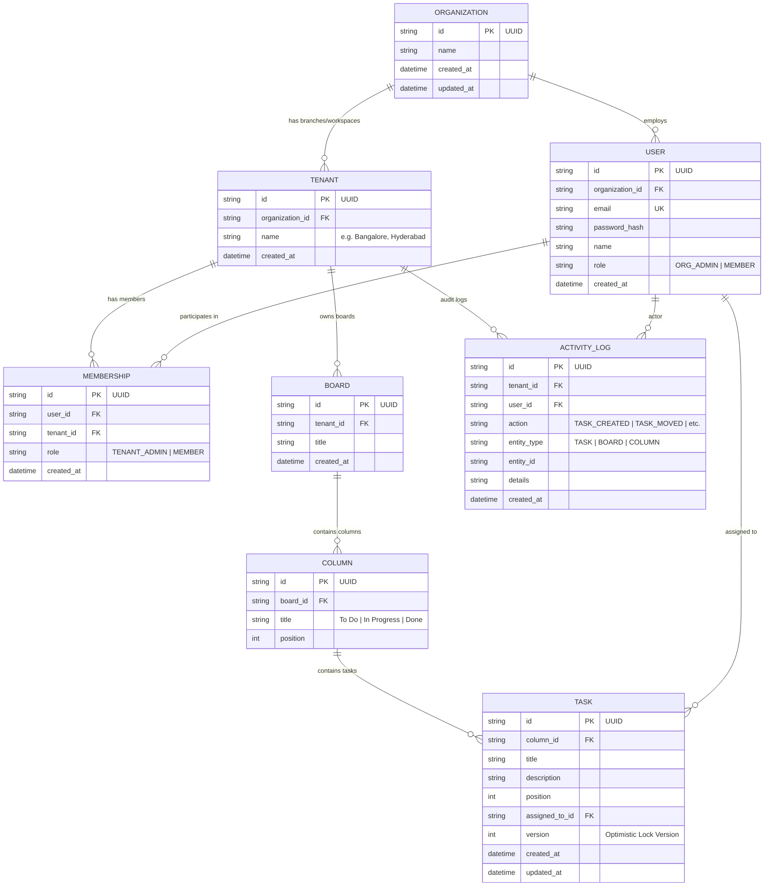

# 📋 Multi-Tenant Collaborative Kanban Board System


A production-ready, full-stack collaborative Kanban board platform engineered with multi-tenant data isolation, optimistic concurrency locking, real-time WebSocket synchronization, and role-based access control (RBAC).

---

## 📑 Table of Contents
1. [Architecture Overview](#-architecture-overview)
2. [Multi-Tenancy Model & Isolation Strategy](#-multi-tenancy-model--isolation-strategy)
3. [Database Schema & ERD (8 Required Tables)](#-database-schema--erd)
4. [Role-Based Access Control (RBAC)](#-role-based-access-control-rbac)
5. [Concurrency & Optimistic Locking (HTTP 409)](#-concurrency--optimistic-locking)
6. [Real-Time Collaboration (Socket.IO)](#-real-time-collaboration)
7. [API Specification](#-api-specification)
8. [WebSocket Event Specification](#-websocket-event-specification)
9. [Local Development & Setup Guide](#-local-development--setup-guide)

---

## 🏛 Architecture Overview

```
                      ┌───────────────────────────────────────────────┐
                      │              Frontend (Vue 3 + Vite)          │
                      │  - Multi-tenant Switcher & Org Directory      │
                      │  - Drag-and-Drop Kanban Canvas                │
                      │  - Optimistic UI updates with 409 handling    │
                      │  - Socket.IO-Client for real-time presence    │
                      └───────────────────────┬───────────────────────┘
                                              │
                      ┌───────────────────────┴───────────────────────┐
                      │       HTTP REST APIs       WebSocket Engine   │
                      │    (Express 5.3 + JWT)     (Socket.IO Server) │
                      └───────────────────────┬───────────────────────┘
                                              │
               ┌──────────────────────────────┴──────────────────────────────┐
               │              Backend Services & Middleware                  │
               │  - Auth Middleware (JWT Token Verification & Hydration)     │
               │  - Tenant Middleware (Strict Boundary Isolation)            │
               │  - Role Middleware (Org Admin / Tenant Admin / Member)       │
               │  - Concurrency Guard (Version Match & 409 Conflict Check)   │
               └──────────────────────────────┬──────────────────────────────┘
                                              │
                                   ┌──────────┴──────────┐
                                   │  Prisma ORM Client  │
                                   └──────────┬──────────┘
                                              │
                      ┌───────────────────────┴───────────────────────┐
                      │          PostgreSQL Database (8 Tables)       │
                      │  organizations | tenants | users | memberships│
                      │  boards | columns | tasks | activity_logs     │
                      └───────────────────────────────────────────────┘
```

---

## 🏢 Multi-Tenancy Model & Isolation Strategy

### Chosen Model: Shared Database, Shared Schema with Discriminator Columns
In this system, all tenants share a single PostgreSQL database instance and schema. Multi-tenancy is enforced through `tenant_id` foreign key relationships combined with application-level security middleware.

### Trade-Offs Analysis

| Approach | Data Isolation | Operational Complexity | Cost Efficiency | Resource Scalability |
| :--- | :---: | :---: | :---: | :---: |
| **Separate DB per Tenant** | Highest | Very High (Migrating 1,000 DBs) | Poor (Idle DB overhead) | Difficult |
| **Schema per Tenant** | Medium-High | High (DDL migrations across schemas) | Moderate | Moderate |
| **Shared DB & Discriminator Columns** *(Our Choice)* | High (Middleware verified) | Low (Single migration pipeline) | Best (Maximized resource sharing) | High (Index-driven scaling) |

### Strict Boundary Enforcement
1. **Header Verification (`x-tenant-id`)**: Every board query, task mutation, and workspace action requires a valid `x-tenant-id` header or valid route context.
2. **Membership Check (`verifyTenantAccess`)**: The backend verifies that the authenticated user (`req.user.id`) possesses an active record in `memberships` for that `tenant_id` before querying the database.
3. **Cascading Deletions**: Deleting a tenant cleanly purges all its boards, columns, tasks, and activity logs without leaving orphaned records.

---

## 🗄 Database Schema & ERD

The database contains all **8 required tables**:



Detailed ER diagram documentation is also available in [`docs/database-erd.md`](file:///d:/tech/React-App/kanban-board/docs/database-erd.md).

---

## 🛡 Role-Based Access Control (RBAC)

The application implements a dual-tiered permission matrix:

| Action | `ORG_ADMIN` | `TENANT_ADMIN` | `MEMBER` |
| :--- | :---: | :---: | :---: |
| Create / Edit Organization Details | ✅ | ❌ | ❌ |
| Create / Delete Tenant Workspaces | ✅ | ❌ | ❌ |
| Create Boards & Columns | ✅ | ✅ | ❌ |
| Delete Columns & Boards | ✅ | ✅ | ❌ |
| Create, Edit & Move Tasks | ✅ | ✅ | ✅ |
| Assign Tasks to Teammates | ✅ | ✅ | ✅ |
| View Boards & Activity Logs | ✅ | ✅ | ✅ |

Enforced via [`server/src/middleware/roleMiddleware.js`](file:///d:/tech/React-App/kanban-board/server/src/middleware/roleMiddleware.js).

---

## 🔒 Concurrency & Optimistic Locking

### Problem
When User A and User B open the same task simultaneously, User B's save might silently overwrite User A's changes without detection (lost update anomaly).

### Solution: Version Checking with HTTP 409
1. Every task carries an atomic integer `version` (defaults to `1`).
2. When the client sends `PUT /api/tasks/:taskId`, it passes `{ ..., version: currentTask.version }`.
3. The server checks:
   ```javascript
   if (version !== undefined && Number(version) !== existingTask.version) {
     return res.status(409).json({
       success: false,
       conflict: true,
       error: 'Conflict: This task has been modified by another user.',
       currentTask: existingTask
     });
   }
   ```
4. If the version matches, the task is updated and `version` is atomically incremented:
   ```javascript
   version: { increment: 1 }
   ```
5. If a `409 Conflict` occurs, the frontend notifies the user and automatically synchronizes the board with the latest server state.

---

## ⚡ Real-Time Collaboration (Socket.IO)

The platform supports live multi-user collaboration using **Socket.IO** rooms:

1. **Tenant-Scoped Rooms (`tenant:<tenantId>`)**:
   - Clients automatically join their active workspace room on login/switch.
   - Live presence is broadcast across all users in the same tenant (`presence_update`).
   - Workspace activity logs stream in real-time (`activity_event`).
2. **Board-Scoped Rooms (`board:<boardId>`)**:
   - Clients viewing the same Kanban board join `board:<boardId>`.
   - Real-time events:
     - `task_created`: Injects new task card into the target column instantly.
     - `task_updated`: Updates task details/version across all open screens.
     - `task_moved`: Slides cards between columns in real-time without refreshing.
     - `task_deleted`: Removes cards instantly from other viewers' boards.

---

## 📡 API Specification

All protected endpoints require header: `Authorization: Bearer <JWT_TOKEN>`.
All tenant-scoped endpoints require header: `x-tenant-id: <TENANT_ID>`.

### Authentication
* `POST /api/auth/register` (also `/auth/register`):
  - Body: `{ name, email, password, organizationName, tenantName }`
  - Creates user (`ORG_ADMIN`), organization, and initial workspace (`TENANT_ADMIN`).
* `POST /api/auth/login` (also `/auth/login`):
  - Body: `{ email, password }`
  - Returns: `{ token, tenantId, user }`. Token is valid for 7 days.

### Organizations
* `GET /api/organizations/details`: Returns organization name, team members, and workspaces.
* `PUT /api/organizations/update`: Updates organization name (`ORG_ADMIN` only).
* `GET /api/organizations/activities`: Returns recent audit logs for the workspace.

### Workspaces / Tenants
* `GET /api/tenants`: Lists all workspaces available to the authenticated user.
* `POST /api/tenants`: Creates a new workspace (`ORG_ADMIN` or `TENANT_ADMIN`).
* `PUT /api/tenants/:tenantId`: Updates workspace name.
* `DELETE /api/tenants/:tenantId`: Deletes workspace (`ORG_ADMIN` only).

### Boards & Columns
* `GET /api/boards/getBoard`: Returns all boards in the active workspace.
* `GET /api/boards/:boardId`: Returns board details with nested columns and tasks.
* `POST /api/boards/createBoard`: Creates a board with default columns (`To Do`, `In Progress`, `Done`).
* `POST /api/columns/createColumn`: Adds a custom column to a board.
* `PUT /api/columns/updateColumn/:columnId`: Renames or repositions a column.
* `DELETE /api/columns/deleteColumn/:columnId`: Deletes a column and its tasks.

### Tasks
* `POST /api/tasks`: Creates a new card in a column.
* `PUT /api/tasks/:taskId`: Updates card details, moves card, or updates position. Enforces optimistic locking (`version`).
* `DELETE /api/tasks/:taskId`: Deletes a card.

---

## 🔌 WebSocket Event Specification

| Event | Scope | Payload | Description |
| :--- | :--- | :--- | :--- |
| `join_tenant` | Client → Server | `{ tenantId, user }` | Joins workspace presence room. |
| `join_board` | Client → Server | `{ boardId }` | Joins board room for live task sync. |
| `leave_board` | Client → Server | `{ boardId }` | Leaves board room. |
| `presence_update` | Server → Client | `[ { id, name, email, status } ]` | Broadcasts active online teammates. |
| `task_created` | Server → Client | `{ task }` | Injects new card into other clients' boards. |
| `task_updated` | Server → Client | `{ updatedTask }` | Updates card title/desc/version live. |
| `task_moved` | Server → Client | `{ taskId, targetColumnId, newPosition }` | Synchronizes drag-and-drop card movement. |
| `task_deleted` | Server → Client | `{ taskId, columnId }` | Removes card from viewers' screens. |
| `activity_event` | Server → Client | `{ action, details, userName, timestamp }` | Streams live workspace activity logs. |

---

## 🚀 Local Development & Setup Guide

### Prerequisites
- **Node.js** v18+ (tested on Node v24)
- **PostgreSQL** or Prisma local dev database

### 1. Backend Setup
```bash
cd server
npm install

# Start local PostgreSQL database (Prisma Dev)
npm run db:start

# Synchronize database schema
npx prisma db push

# Start Backend Server & WebSockets
npm run dev
# Server will listen on http://localhost:5000
```

### 2. Frontend Setup
```bash
cd client
npm install

# Copy environment template (or customize as needed)
cp .env.example .env

# Start Vite Development Server
npm run dev
# Client will be accessible at http://localhost:5173
```

### 3. Verification & Testing
1. Navigate to `http://localhost:5173/login`.
2. Click **Create Account** to register your Organization Admin and first workspace.
3. Open a second browser session (e.g. Incognito) and observe live presence indicators and task updates in real-time as cards are moved!

