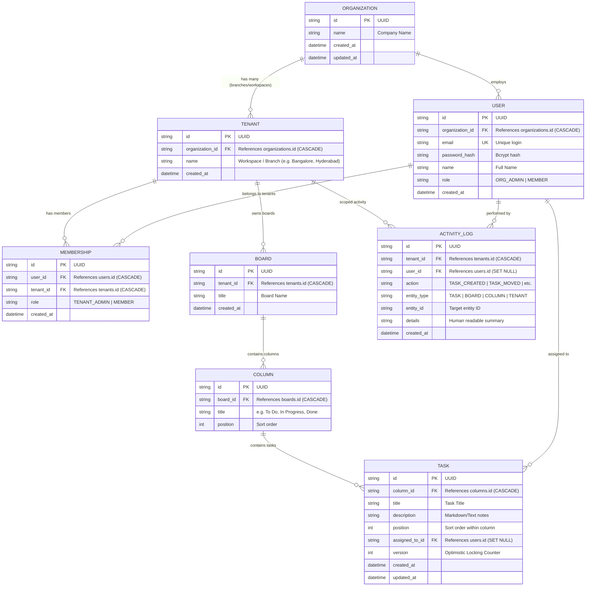

# Database Entity-Relationship Diagram (ERD)

This document visualizes the 8-table relational schema powering the multi-tenant collaborative Kanban board.

---

## Table Relationships & Cardinality

| Parent Table | Child Table | Cardinality | Foreign Key Constraint | Description |
| :--- | :--- | :---: | :--- | :--- |
| `organizations` | `tenants` | 1 : N | `ON DELETE CASCADE` | Deleting an organization removes all its workspace branches. |
| `organizations` | `users` | 1 : N | `ON DELETE CASCADE` | Every user belongs to a parent organization. |
| `users` & `tenants` | `memberships` | N : M | `ON DELETE CASCADE` | Join table defining which users have access to which workspaces and their workspace role (`TENANT_ADMIN` vs `MEMBER`). |
| `tenants` | `boards` | 1 : N | `ON DELETE CASCADE` | **Tenant Isolation Boundary**: Boards belong strictly to one tenant. |
| `boards` | `columns` | 1 : N | `ON DELETE CASCADE` | Columns (`To Do`, `In Progress`, `Done`) are ordered by `position`. |
| `columns` | `tasks` | 1 : N | `ON DELETE CASCADE` | Tasks belong to columns. |
| `users` | `tasks` | 1 : N | `ON DELETE SET NULL` | Assignee relation; deleting a user unassigns tasks safely. |
| `tenants` | `activity_logs` | 1 : N | `ON DELETE CASCADE` | Persistent audit trail for actions within that workspace. |

